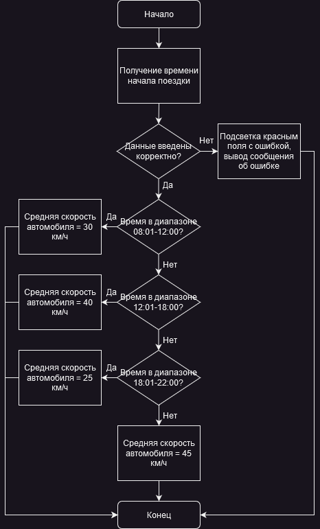
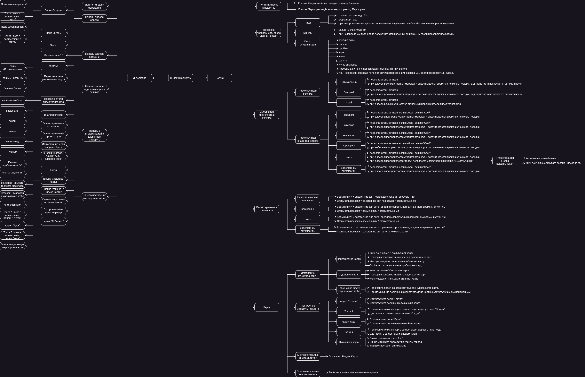

# Яндекс.Маршруты — тест-анализ и тест-дизайн

Учебный проект первого спринта Яндекс Практикума. Я разобрал требования к Яндекс.Маршрутам 1.0, выделил классы эквивалентности и спроектировал проверки расчёта поездки на собственном автомобиле.

## 1. Задача и границы проекта

Для всего приложения нужно было структурировать требования и показать связи между интерфейсом и логикой. Для одного вида транспорта — разобрать выбор средней скорости, подготовить тестовые данные и написать тест-кейсы для расчёта времени и стоимости. Я выбрал собственный автомобиль в режиме «Свой».

## 2. Как я разобрал требования

В mind map я детализировал две ветви учебного шаблона — интерфейс и логику. Интерфейс охватывает поля адреса и времени, режимы, транспорт и карту. В логике я выделил валидацию ввода, выбор транспорта, построение маршрута и расчёт поездки.

В блок-схеме я показал выбор средней скорости автомобиля. Некорректное время ведёт к подсветке поля и сообщению об ошибке. Для корректного ввода скорость определяется интервалом. Например, **12:00 → 30 км/ч**, а **12:01 → 40 км/ч**.

## 3. Как я спроектировал проверки

| Артефакт | Что в нём |
| --- | --- |
| Классы эквивалентности, часть 1 | Часы, минуты и оба адресных поля. Валидные и невалидные классы, значения внутри класса и на границах. Например, 23 и 24 для часов, 59 и 60 для минут. |
| Классы эквивалентности, часть 2 | Нулевое и положительное расстояние, интервалы времени начала движения. Повторяющиеся значения на соседних границах отмечены для оптимизации проверок. |
| Тест-кейсы | Предусловия, шаги и ожидаемые результаты расчёта времени и ориентировочной стоимости. |

**Пример из тест-кейса t-1.** Для поездки в 03:48 на собственном автомобиле в таблице использованы расстояние 3,7 км, средняя скорость 45 км/ч и тариф 20 ₽/км. Расчёт даёт около 4,93 минуты и 74 ₽. Ожидаемый результат в интерфейсе — **5 минут и около 74 ₽**. Это ожидаемый результат тест-дизайна.

[Полная таблица с классами и тест-кейсами](https://docs.google.com/spreadsheets/d/1IL9Ao30jX4oCnCnEM5JV5Dkn2QOAmWboFc8VaP5oSzc/edit?usp=sharing) · [Документ, сданный на ревью](https://docs.google.com/document/d/1x3JQd8Yg-HVb-e5gXuAcVog4ZUBRUKsJzWDdBVlslGM/edit?usp=sharing)

## 4. Диаграммы

**Блок-схема выбора скорости автомобиля**

[Редактируемый файл draw.io](diagrams/yandex-routes-block-diagram.drawio)

Mind map требований к Яндекс.Маршрутам

[PNG в полном размере](previews/mindmap.png) · [Редактируемый файл draw.io](diagrams/yandex-routes-mindmap.drawio)

